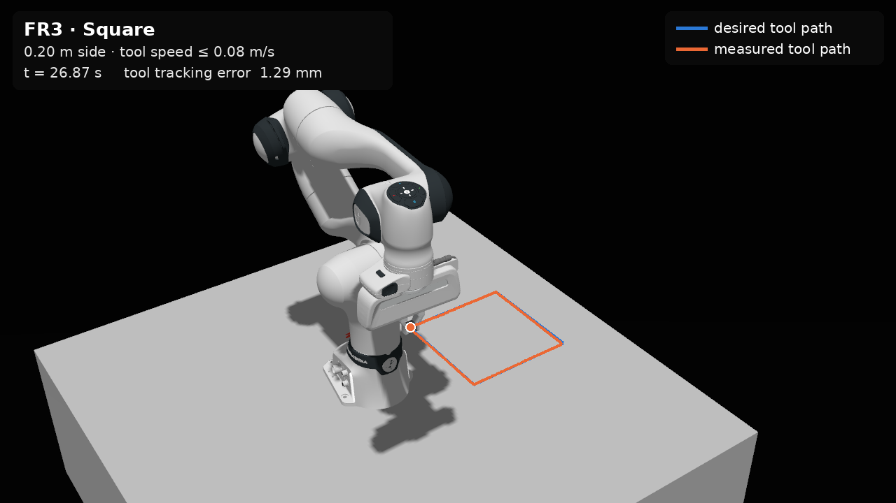

# ROS 2 Franka FR3 Arm Control

A ROS 2 Jazzy simulation and control stack for a Franka FR3 arm with the Franka Hand. It uses Pinocchio for rigid-body dynamics, a PD controller with gravity compensation, MoveIt 2 for motion planning, quintic joint trajectories, Gazebo Sim and `ros2_control`.

## Packages

- `arm_sim`: FR3 + hand URDF and meshes, Gazebo world, simulation launch
- `arm_control`: PD + gravity-compensation controller (`controller_node`) and the `ros2_control` controller configuration
- `arm_traj_gen`: quintic joint trajectory generator (`traj_gen_node`) with URDF joint-limit checks, and the `FollowJointTrajectory` action server (`trajectory_action_server`) that executes MoveIt trajectories
- `fr3_moveit_config`: MoveIt configuration for the FR3 (SRDF, KDL kinematics, joint limits, controller config) and `moveit_sim.launch.py` (`move_group` + RViz)
- `arm_kinodynamics`: Pinocchio library: arm model loading, kinematics, Jacobian and dynamics
- `arm_bringup`: launch files for the full system, with or without MoveIt, and `planning_scene_setup`, which adds the platform and the ground to MoveIt's planning scene
- `arm_description`: RViz display launch

## How it fits together

```
traj_gen_node ──/desired_joint_states──▶ controller_node ──/effort_controller/commands──▶ Gazebo (gz_ros2_control)
      ▲                                        ▲                                              │
      └───────────────/joint_states────────────┴──────────── joint_state_broadcaster ◀────────┘
```

- The controller and trajectory generator load the FR3 URDF with the finger joints locked. That gives a 7-joint arm model that still includes the hand's mass for gravity compensation.
- `controller_node` runs a small state machine:
  - `WAITING`: no joint state received yet
  - `FALLBACK`: gravity compensation only (no fresh trajectory, or stale data)
  - `TRACKING`: PD + gravity compensation on the desired trajectory
- `traj_gen_node` reads the arm's current position, checks the start and the target against the URDF joint limits, and publishes a 5 s quintic move of `fr3_joint1` by +0.1 rad.

With MoveIt, `trajectory_action_server` takes the place of `traj_gen_node`:

```
RViz ──▶ move_group ──FollowJointTrajectory──▶ trajectory_action_server ──/desired_joint_states──▶ controller_node ──▶ Gazebo
          (planning)   /fr3_arm_controller/          ▲                                                   │
                       follow_joint_trajectory       └──────────────────/joint_states────────────────────┘
```

- `trajectory_action_server` holds the arm at its first measured pose. When a trajectory arrives, it streams it to `/desired_joint_states` at 1 kHz, using cubic interpolation between the trajectory points (positions and velocities), then holds the final point.
- A cancel (RViz **Stop**) freezes the arm where it is. A new goal replaces a running one. Goals with the wrong joints or point sizes, or sent before the first joint state, are rejected.
- Trajectory timing follows the simulation clock (`use_sim_time`), the same clock `move_group` uses.
- `planning_scene_setup` adds the robot platform and the ground to MoveIt's planning scene as collision boxes once `move_group` is up, then exits. Plans then avoid them.
  - The sizes and positions are in `arm_bringup/config/planning_scene.yaml`, in MoveIt's frame (the robot base). They must match `arm_sim/worlds/fr3_world.sdf`, where the robot is spawned at z = 0.4 m.
  - The platform box sits 5 mm below the base, because `fr3_link0`'s collision mesh rests exactly on the platform top. Without the gap, every start state would count as in collision.

## Requirements

- ROS 2 Jazzy (`/opt/ros/jazzy`)
- Gazebo Sim Harmonic
- `ros2_control`, `gz_ros2_control`, `ros_gz_sim`, `ros_gz_bridge`, `xacro`
- MoveIt 2 (`ros-jazzy-moveit`)
- Pinocchio 4 (e.g. from robotpkg in `/opt/openrobots`)
- `colcon`

Build and run from the system ROS installation. If a conda environment is active, run `conda deactivate` first: mixing conda's Python or linker with `/opt/ros/jazzy` breaks both the build and `ros2`.

## Build

```bash
cd ~/ros2-arm-control
source /opt/ros/jazzy/setup.zsh
colcon build --symlink-install
source install/setup.zsh
```

These commands are for zsh. In bash, source `setup.bash` instead of `setup.zsh` (both for `/opt/ros/jazzy` and `install/`). The zsh files fail in bash with `bad substitution`.

## Run

### Full system

Starts Gazebo with the FR3, the controllers, `controller_node`, and then `traj_gen_node` once the effort controller is active:

```bash
ros2 launch arm_bringup full_system.launch.py
```

Without the Gazebo GUI:

```bash
ros2 launch arm_bringup full_system.launch.py headless:=true
```

The arm spawns at the home pose `[0, -π/4, 0, -3π/4, 0, π/2, π/4]`, then rotates joint 1 by 0.1 rad over 5 s and holds.

### Motion planning with MoveIt

Starts the full system with `trajectory_action_server` instead of `traj_gen_node`, plus `move_group` and RViz:

```bash
QT_QPA_PLATFORM=xcb ros2 launch arm_bringup moveit_system.launch.py
```

`QT_QPA_PLATFORM=xcb` makes RViz use X11. On a Wayland desktop, RViz otherwise fails with `Unable to create the rendering window`. Add `headless:=true` to run Gazebo without its GUI.

Once the log shows `Holding initial position.`, in RViz's **MotionPlanning** panel:

1. Planning Group `fr3_arm`, Start State `<current>`.
2. Set a goal: drag the marker at the hand, or choose a Goal State such as `ready` or `<random valid>`.
3. **Plan** to preview, or **Plan & Execute** to move the arm in Gazebo. **Stop** cancels the motion.

The RViz config saves the marker size (MotionPlanning → Planning Request → Interactive Marker Size) and the path preview (Planned Path → Loop Animation). Change them in RViz, then **File → Save Config**.

A trajectory can also be sent without RViz. This one moves joint 1 to 0.3 rad over 3 s and prints the tracking feedback:

```bash
ros2 action send_goal --feedback /fr3_arm_controller/follow_joint_trajectory control_msgs/action/FollowJointTrajectory \
"{trajectory: {joint_names: [fr3_joint1, fr3_joint2, fr3_joint3, fr3_joint4, fr3_joint5, fr3_joint6, fr3_joint7],
  points: [{positions: [0.3, -0.7854, 0.0, -2.3562, 0.0, 1.5708, 0.7854], time_from_start: {sec: 3}}]}}"
```

The platform and the ground show in RViz as green boxes (MotionPlanning → Scene Geometry). A goal inside them turns the arm red and can't be planned to.

Don't run `traj_gen_node` at the same time: both nodes publish `/desired_joint_states`.

### Simulation only

Starts Gazebo, the `/clock` bridge and `robot_state_publisher`, spawns the FR3, and loads `joint_state_broadcaster` and `effort_controller`:

```bash
ros2 launch arm_sim sim.launch.py            # add headless:=true for no GUI
```

Then start the nodes in separate terminals, controller first so the arm is held against gravity:

```bash
ros2 run arm_control controller_node
ros2 run arm_traj_gen traj_gen_node
```

### Visualize in RViz

With the simulation running (it already publishes `/robot_description` and TF):

```bash
ros2 run rviz2 rviz2
```

In RViz, set **Fixed Frame** to `world` and add a **RobotModel** display (Description Topic: `/robot_description`) and a **TF** display.

Without the simulation, `display.launch.py` starts `robot_state_publisher` with the FR3 URDF and RViz. With no joint states, only the fixed links get transforms:

```bash
ros2 launch arm_description display.launch.py
```

## Controller performance

The FR3 following five tool paths planned by MoveIt, in the horizontal plane at z = 0.40 m, at ≤ 0.08 m/s, with the current gains (`Kp = [200, 200, 200, 200, 50, 50, 5]`, `Kd = [20, 20, 20, 20, 5, 5, 0.2]`):

| Path | Tool tracking error, max / RMS |
|---|---|
| Two-point line | 2.04 / 1.79 mm |
| Square | 2.38 / 1.63 mm |
| Diamond | 2.31 / 1.74 mm |
| Circle | 3.46 / 1.80 mm |
| Curved path | 2.29 / 1.60 mm |



- Joint friction (0.2 Nm in the URDF) leaves a dead band of 0.2 Nm / Kp on each joint: 40 mrad on joint 7 and 1.2–1.3 mm of tool offset when the arm stops.
- Near configurations where joint 2 is about 0, joints 1 and 3 chatter, and the error reached 33.7 mm.

Videos, plots, the planned trajectories, run logs and the script to regenerate them are in [docs/media/fr3_trajectories](docs/media/fr3_trajectories/README.md).

## Tests

```bash
colcon test --packages-select arm_kinodynamics arm_traj_gen arm_control
colcon test-result --verbose
```

The `arm_traj_gen` integration test runs `traj_gen_node` on its own ROS domain, so it doesn't interfere with a running simulation.

## Useful Commands

```bash
ros2 control list_controllers                 # controller status
ros2 topic echo /joint_states                 # measured joint states (arm + fingers)
ros2 topic echo /desired_joint_states         # trajectory generator output
ros2 topic echo /effort_controller/commands   # controller torques (fr3_joint1..7)
ros2 topic echo /clock                        # simulation time
ros2 action info /fr3_arm_controller/follow_joint_trajectory   # MoveIt execution: 1 action server expected
```

## Troubleshooting

- **`ModuleNotFoundError: No module named 'rclpy._rclpy_pybind11'`**: a conda environment is active. Run `conda deactivate`, then source `/opt/ros/jazzy/setup.zsh` and `install/setup.zsh` again. `which ros2` should print `/opt/ros/jazzy/bin/ros2`.
- **`bad substitution` / `No module named 'ament_package'` during the build**: the `.zsh` setup files were sourced from bash. Use `setup.bash` in bash, or switch to zsh.
- **The arm shakes**: check for duplicate nodes left over from an earlier launch with `ros2 node list | sort | uniq -c`, and stop them (`pkill -f controller_node`, `pkill -f traj_gen_node`, `pkill -f "gz sim"`).
- **`[Err] [Physics.cc] ... mimic constraint for joint [fr3_finger_joint2]`**: harmless. Gazebo's default physics engine does not support the URDF mimic tag, so both fingers are driven directly through `ros2_control` instead.
- **RViz or the MoveIt Setup Assistant crashes with `Unable to create the rendering window`**: start it with `QT_QPA_PLATFORM=xcb` (Wayland desktops).
- **Execute fails with `Action client not connected to action server: fr3_arm_controller/follow_joint_trajectory`**: `trajectory_action_server` isn't running, for example when `moveit_sim.launch.py` was started on its own. Use `moveit_system.launch.py`.
- **`No 3D sensor plugin(s) defined for octomap updates`**: harmless; there's no depth sensor.
- **`move_group` prints a stack trace or `exit code -11` on Ctrl+C**: a known MoveIt crash on exit in Jazzy, after it has already stopped. Harmless.

## Robot model

The FR3 + Franka Hand URDF and meshes in `arm_sim` come from [franka_description](https://github.com/frankarobotics/franka_description) 2.9.0 (Apache-2.0). Their license and notice are in `src/arm_sim/meshes/`, and the hand edits are listed at the top of `src/arm_sim/urdf/fr3.urdf`.

## License

MIT
