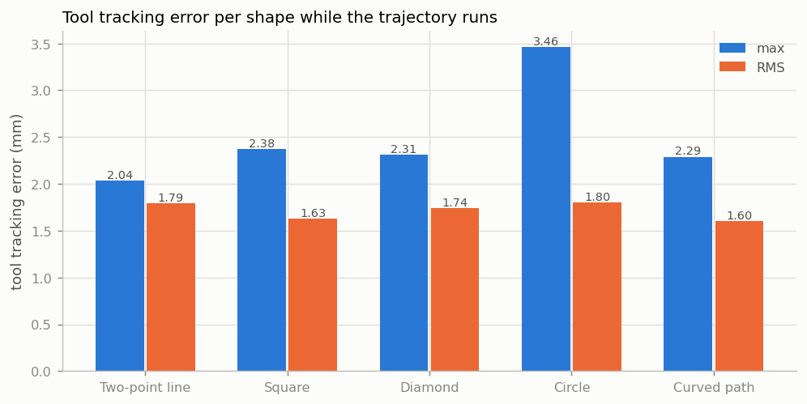
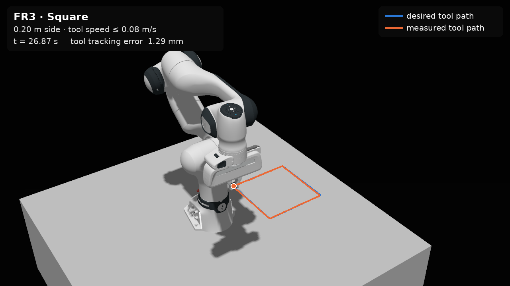
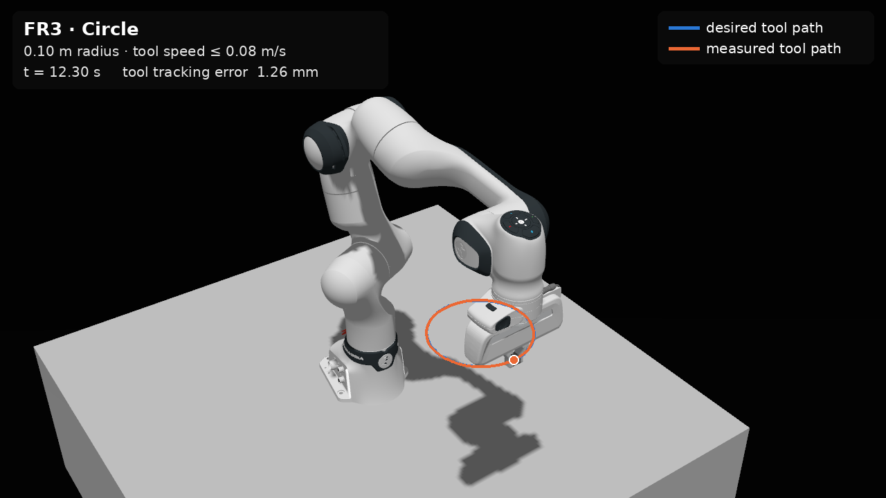
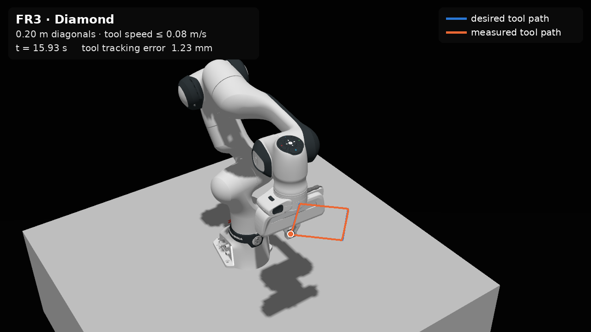
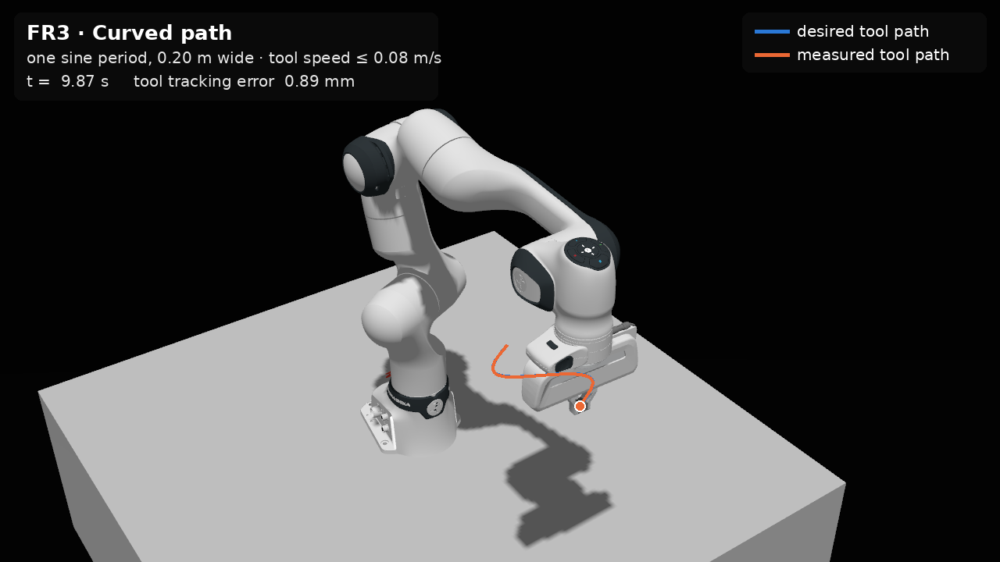

# FR3 trajectory tracking with MoveIt

Videos, plots and data of the simulated FR3 following five tool paths with the project's PD + gravity-compensation controller and its current gains. The paths are planned by MoveIt, and these are the results as measured, including the weak spots.

**Pipeline:** MoveIt `/compute_cartesian_path` plans each path, and MoveIt `/execute_trajectory` executes it: `trajectory_action_server` streams it to `controller_node`, which drives Gazebo. This is the same stack as `ros2 launch arm_bringup moveit_system.launch.py`, unchanged. No planner of our own is involved.

## Setup

| | |
|---|---|
| Paths | in the horizontal **x–y plane** at **z = 0.40 m** (robot base frame), centred at x = 0.40 m, y = 0. The hand points down, as at home |
| Size | 0.20 m square, 0.20 m diamond diagonals, 0.10 m circle radius, 0.28 m diagonal line, one sine period 0.20 m wide |
| Tool speed | ≤ **0.08 m/s** (`fr3_hand_tcp`) |
| Controller | `Kp = [200, 200, 200, 200, 50, 50, 5]`, `Kd = [20, 20, 20, 20, 5, 5, 0.2]`, 1 kHz |
| Joint friction (URDF) | 0.2 Nm on every joint |

Between paths the arm returns to the home tool pose. Each path starts from rest at its first point.

## Results

| Path | Duration | Tool tracking error, max / RMS | Path deviation, max / RMS | Video | Plot |
|---|---|---|---|---|---|
| Two-point line | 6.9 s | 2.04 / 1.79 mm | 1.67 / 1.08 mm | [line.mp4](line.mp4) | [line_plot.png](line_plot.png) |
| Square | 25.4 s | 2.38 / 1.63 mm | 1.81 / 1.04 mm | [square.mp4](square.mp4) | [square_plot.png](square_plot.png) |
| Diamond | 14.5 s | 2.31 / 1.74 mm | 1.67 / 0.84 mm | [diamond.mp4](diamond.mp4) | [diamond_plot.png](diamond_plot.png) |
| Circle | 10.8 s | 3.46 / 1.80 mm | 1.35 / 0.89 mm | [circle.mp4](circle.mp4) | [circle_plot.png](circle_plot.png) |
| Curved path | 8.4 s | 2.29 / 1.60 mm | 1.60 / 0.72 mm | [curve.mp4](curve.mp4) | [curve_plot.png](curve_plot.png) |

- **Tool tracking error:** the distance between where the tool should be at that instant (forward kinematics of the streamed `/desired_joint_states`) and where it is (forward kinematics of `/joint_states`). It includes lag along the path.
- **Path deviation:** the distance from the measured tool position to the ideal shape, ignoring timing.
- Both are measured only while the trajectory runs. All numbers are in [results.json](results.json).



| | |
|---|---|
|  |  |
|  |  |

The images are the last frame of each video. Blue is the desired tool path and orange the measured one; the desired path is drawn at the tool's height.

## What the results show

- **Static offsets come from friction, at 0.2 Nm / Kp.** Every joint has 0.2 Nm of Coulomb friction in the URDF, and the PD only overcomes it once `Kp · error` exceeds 0.2 Nm. That gives a dead band of about 1 mrad on joints 1–4 (Kp 200), 4 mrad on joints 5–6 (Kp 50) and **40 mrad on joint 7** (Kp 5). These are the flat steps in the joint-error plots. Because of them, the tool settles about **1.2–1.3 mm** from its target when the arm stops (0.9 mm for the curved path).
- **Joint 7 sits at ±40 mrad** for most of every motion and flips sign whenever its direction reverses. Joint 7 turns about the tool axis, so this costs tool *orientation* (up to 2.3°), not tool position.
- **Tracking lag grows with acceleration.** The largest errors are at the start of a path and where the direction changes: the circle reaches 3.46 mm at 0.7 s, while it speeds up from rest. There is no feed-forward of the desired acceleration, so the PD has to build up an error to make the torque for it.
- **Near-singular region (not in the videos).** A first attempt placed the paths at x = 0.45 m, z = 0.30 m. On the far edge of the square, x = 0.55 m, joint 2 passes through about 0 rad. There, joints 1 and 3 rotate about almost the same axis, the two independent PD loops chattered against each other, and the tool tracking error reached **33.7 mm**, against 2.4 mm in the current plane. The paths were moved to x = 0.40 m, z = 0.40 m, where joint 2 stays between −0.85 and −0.16 rad. Expect the same behaviour anywhere joint 2 is near 0 with the current gains.

## Regenerate

From the repo root, in zsh with no conda env active and the workspace built:

```zsh
source /opt/ros/jazzy/setup.zsh
source install/setup.zsh
python3 docs/media/fr3_trajectories/make_trajectory_videos.py .               # all five paths
python3 docs/media/fr3_trajectories/make_trajectory_videos.py . circle square # only some
```

All five take about 6–8 minutes. The script runs on its own ROS domain (87) and Gazebo partition, so it doesn't interfere with a simulation you have open, and RViz isn't opened. To get video out of Gazebo, it temporarily overlays the `arm_sim` package with a copy of `fr3_world.sdf` that has Gazebo's Sensors system and a camera, the same way as [../fr3_workspace](../fr3_workspace). Nothing in `src/` or `install/` is modified.

The plane position, shape size and tool speed are constants at the top of `make_trajectory_videos.py` (`CENTER`, `HALF`, `TCP_SPEED`).

**Tool speed:** MoveIt's `/compute_cartesian_path` ignores the request's `max_cartesian_speed` here. Its trajectories reached 0.36 m/s. So the script stretches MoveIt's timing uniformly, multiplying time by k, dividing velocities by k and accelerations by k², until the peak tool speed, computed from the Jacobian, is 0.08 m/s. The path and its smoothness are unchanged.

## Data

| File | Contents |
|---|---|
| `trajectories/<path>.csv` | The planned joint trajectory as executed: `t`, then `q`, `qd`, `qdd` for `fr3_joint1..7` |
| `trajectories/<path>_goal.yaml` | The same trajectory as a `FollowJointTrajectory` goal |
| `logs/<path>.csv` | 100 Hz log of the run: desired and measured joint positions, desired and measured tool position (base frame, m) |
| `results.json` | Settings, gains and all metrics |

To replay a trajectory on the running stack (`moveit_system.launch.py`), first move the arm to the path's start pose. The trajectory begins there, and the action server would otherwise jump straight to its first point:

```zsh
ros2 action send_goal /fr3_arm_controller/follow_joint_trajectory \
  control_msgs/action/FollowJointTrajectory "$(cat docs/media/fr3_trajectories/trajectories/circle_goal.yaml)"
```

GitHub doesn't play `.mp4` files inline from the repository. Open them from the links above, or download them.
